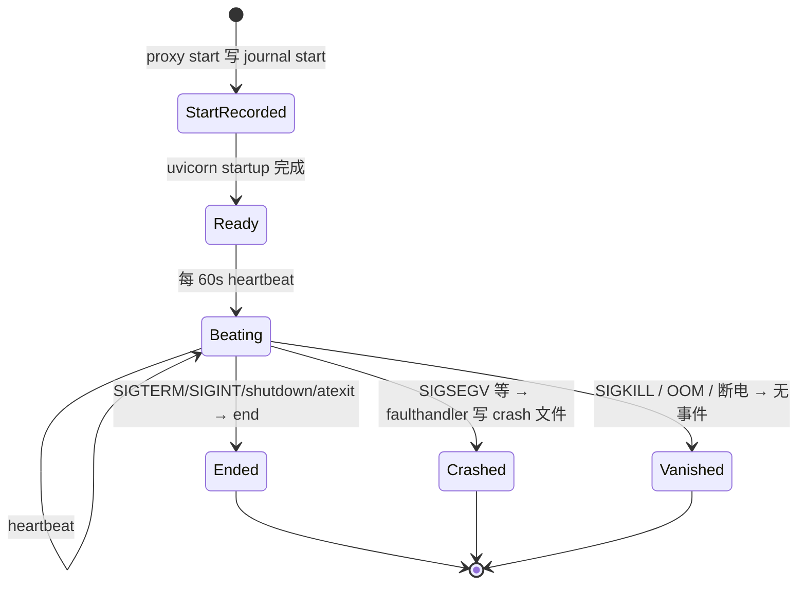
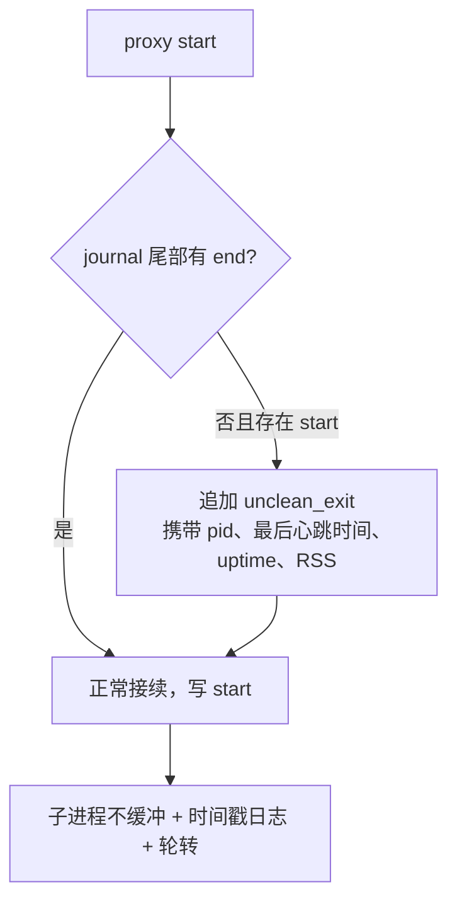

# Gateway Lifecycle Diagnostics - Plan

## Goal Capsule

- **Objective:** 网关下次意外退出后，维护者在一条 `otel-agent proxy status` 输出里就能读到上次会话是谁、什么时候停的、停了之后最后一次健康快照是什么，从而判断该查内存、该查信号、还是该查上游；不再需要从无时间戳的追加日志里反推。
- **Means:** 独立 JSONL 生命周期日志 + 下次启动时的异常退出判定 + 致命信号栈捕获 + 子进程不缓冲与带时间戳的网关日志（KTD1-KTD7）。
- **Authority:** 本计划的 R/KTD 优先；`docs/solutions/` 既有约定（PID/日志文件按守护进程分家）不被推翻。
- **Execution profile:** 单个 PR，分支 `feat/proxy-lifecycle-diagnostics`。
- **Stop conditions:** 需要改 telemetry 存储 schema、需要自动重启托管、或需要数据保留/清理策略时停止——这三项都不在本计划内。
- **Finisher:** 本 pipeline 执行实现、验证与提交；不推送、不开 PR。

---

## Product Contract

### Summary

给网关加一条独立的生命周期日志，记录启动、心跳、退出与崩溃，并在下次启动时把"上次没有正常收尾"变成一条可读的结论。`proxy status`、`proxy logs --lifecycle`、`doctor` 直接呈现这条结论，`proxy.log` 本身补上时间戳、不缓冲和有界轮转。

### Problem Frame

2026-11-22 排查"网关为什么突然消失"时，可用的证据链是断的：

- `~/.otel-agent/proxy.log` 里上一个进程（PID 33318）启动后没有任何 shutdown 记录，日志行不带时间戳，无法确定退出时刻，也无法区分"被信号杀掉""崩溃""被系统回收"。
- 子进程 stdout 重定向到文件时 Python 采用块缓冲，异常退出会丢掉最后一段输出——恰恰是最有价值的那段。
- `otel-agent proxy status` 只看 PID 文件里的进程是否存活，进程一消失就只剩"No gateway was running"。
- 没有 `faulthandler`，原生崩溃（SIGSEGV/SIGABRT）不留 Python 栈。
- 日志 14 MB 且无轮转，`telemetry.sqlite` 已 28 GB，运维信号淹没在体量里。

结论：网关缺一层"退出是一次一等事件"的记录，而不是缺日志量。

### Requirements

**事件记录**

- R1. 网关每次启动向 `~/.otel-agent/lifecycle.jsonl` 追加一条 `start` 事件，含 UTC 时间戳、pid、端口、版本、配置路径与完整 argv。
- R2. 运行期每 60 秒追加一条 `heartbeat`，含该进程的峰值 RSS、线程数与已运行秒数。采样只用标准库（`resource.getrusage`、`threading`），不新增依赖；macOS 无 `/proc`，因此不采集 fd 数。
- R3. `lifecycle.jsonl` 不会无限增长：启动时若已超过 1 MB，轮转为 `lifecycle.jsonl.1`（只保留一份）。

**退出与崩溃捕获**

- R4. 进程正常收尾时（收到 SIGTERM/SIGINT/SIGHUP、FastAPI shutdown 回调、解释器退出）追加一条带 `reason` 的 `end` 事件，reason 区分 `signal`、`shutdown`、`atexit`。
- R5. 未捕获异常与致命信号（SIGSEGV/SIGABRT/SIGBUS/SIGFPE/SIGILL）必须留下 Python 栈：前者经 excepthook 写入 `lifecycle-crash.log`，后者由 `faulthandler` 写入同一文件。
- R6. 下一次 `proxy start` 时，如果 journal 中最后一个 `start` 之后没有对应 `end`，追加一条 `unclean_exit` 结论事件，记录上一次的 pid、最后心跳时间、最后心跳的 uptime 与 RSS。

**呈现**

- R7. `otel-agent proxy status` 在存在未收尾会话时，于状态行之后打印上次会话的 pid、最后心跳时间、最后快照与一句下一步建议；无未收尾会话时不打印。
- R8. `otel-agent proxy logs --lifecycle` 打印 journal 尾部若干条（默认 20），`-n` 可覆盖。
- R9. `otel-agent doctor` 增加两项检查：近 7 天 `unclean_exit` 次数（≥1 时提示）与 `telemetry.sqlite` 体积（≥10 GiB 时提示）。
- R10. `GET /health` 在保留 `status: "ok"` 第一字段的前提下，增加 `pid`、`uptime_seconds`、`version`、`last_heartbeat`。

**日志可读性与有界性**

- R11. 后台启动的子进程以不缓冲输出运行，进程异常终止时 `proxy.log` 不丢尾部。
- R12. `proxy.log` 每行带本地时间戳。
- R13. `proxy start` 时若 `proxy.log` 超过 20 MB，轮转为 `proxy.log.1`（只保留一份），`proxy logs` 行为不变。

### Scope Boundaries

- **Not built:** 崩溃后自动重启 / launchd KeepAlive 托管。用户已明确本次只做可诊断性；自动重启会把"曾发生退出"变成需要读 journal 才知道的隐性事件，先把记录做对。
- **Not built:** 把生命周期事件写进 `telemetry.sqlite`。28 GB 的库 + WAL 在进程骤停时是最不可靠的写目标，而诊断恰恰要在那种时刻读到东西（KTD1）。
- **Not built:** telemetry 数据保留、VACUUM、分区清理。`doctor` 只做体积提示，策略是独立的产品决定。
- **Not built:** Prometheus/OTLP 指标导出与跨机聚合。当前只有单机单网关。

### Acceptance Examples

- AE1. **`kill -9` 之后重启。** 给定网关正在运行，运维者 `kill -9` 该 pid 后执行 `proxy restart`：journal 出现新的 `unclean_exit` 事件，`proxy status` 打印上次 pid 与最后心跳时间，`doctor` 的 7 天计数加一。
- AE2. **`proxy stop` 之后重启。** journal 中上一次会话以 `end(reason=signal)` 收尾，`proxy status` 不打印任何异常退出提示。
- AE3. **历史 journal 尾部无 `end` 但 pid 已消失。** 判定为 `unclean_exit`，且不因 journal 被轮转截断而报错。
- AE4. **journal 超过 1 MB。** 启动后存在 `lifecycle.jsonl.1`，新文件从 `start` 事件开始，旧文件内容是轮转前的尾部。

---

## Planning Contract

### Key Technical Decisions

KTD1. **生命周期记录是独立 append-only JSONL 文件，不进 SQLite。** 崩溃时刻最可靠的写路径是"open-append-write-flush"；`telemetry.sqlite` 带 WAL 且已 28 GB，进程横死时既可能写不进去，也可能把读端一起拖住。*(session-settled: user-approved — 本次范围限定为可诊断性，未选 launchd 托管。)*

KTD2. **未收尾判定基于"最后一条事件不是 `end`"，按 pid 归属，不回写历史事件。** journal 只追加，任何一次写失败都不会篡改更早的证据；下次启动把结论追加成一条独立的 `unclean_exit`，读端因此永远看到完整历史。

KTD3. **崩溃捕获用 `faulthandler` + excepthook，信号用"记录后委托"的顺序。** uvicorn 会自己安装 SIGTERM/SIGINT handler；我们在它之后安装包装 handler：先追加 `end(reason=signal)`，再调用捕获到的原 handler，从而保留优雅停机语义。原生 crash 栈落到独立的 `lifecycle-crash.log`，不与 journal 的行格式混写。

KTD4. **后台子进程启动时加 `PYTHONUNBUFFERED=1`，uvicorn 使用带 `asctime` 的 `log_config`。** 这两个是"日志里为什么没有那几行"和"这几行是什么时候写的"的直接答案。轮转只能由父进程在启动时做——子进程持有的是父进程打开的 fd，自己无法安全重新打开。

KTD5. **`/health` 只增加字段，不改 `status`。** 现有探测脚本按 `status == "ok"` 判定，新增字段必须向前兼容。

KTD6. **心跳每 60 秒一次，`flush()` 不 `fsync()`。** 进程被杀时 flush 已足够让数据进入 page cache；只有整机断电才需要 fsync，为那个场景付出每次心跳一次磁盘同步不划算。心跳与信号 handler 可能并发写，因此 journal 的写入在模块级锁内串行化，保证每行完整。

KTD7. **journal 与 crash 文件的路径常量放在 `process.py` 旁边**，与既有 `LOG_FILE`/`PID_FILE` 一致，便于测试用 `patch` 重定向到 `tmp_path`（`tests/test_process.py` 已是这个模式）。

### High-Level Technical Design

生命周期事件与判定路径：

下一次启动的判定：

### Assumptions

- `~/.otel-agent/` 可写（既有 PID/日志文件已依赖此点）。
- 运维入口是 CLI 与 `/health`，这台机器没有指标采集端。
- 只用标准库实现采样与信号捕获，不引入 `psutil` 一类新依赖；因此心跳记录的是峰值 RSS 而非瞬时 RSS。
- uvicorn 在应用 startup 之前安装 SIGTERM/SIGINT handler；实现时需实测确认，若次序不符，则退回 `atexit` + `on_event("shutdown")` 两处记录，不硬编码假设。

### Deferred to Implementation

- 包装 handler 的具体安装点（uvicorn 启动前的 signal 注册 vs. 应用 startup），取决于实测到的 uvicorn 0.34 行为。
- journal 事件字段的最终命名细节；R1/R2/R6 已固定必含语义。
- 心跳是否要随 `--foreground` 与后台两种启动方式有差异（当前判断：无差异）。

---

## Implementation Units

### U1. Lifecycle journal module

- **Goal:** 提供可测试的追加、读取、轮转与"上次会话是否未收尾"判定。
- **Requirements:** R1, R2, R3, R6
- **Dependencies:** none
- **Files:** `src/otel_agent/lifecycle.py` (new), `src/otel_agent/process.py` (path constants), `tests/test_lifecycle.py` (new)
- **Approach:**
  1. `append_event(event, **fields)`：写一行 JSON（`ts` 为 UTC ISO-8601，`event`，其余字段），`flush()`，失败只返回 False、不抛给调用方——诊断代码不允许成为新的故障源；写入在模块级锁内完成，单次 `write` 一次成行。
  2. `read_events(limit=None)`：逐行容错解析，跳过损坏行。
  3. `summarize_last_session()`：返回 pid、`started_at`、`last_heartbeat_at`、`ended`（bool）、最后心跳快照。
  4. `rotate_if_needed(max_bytes=1MB)`：超限时 `lifecycle.jsonl` → `.1`。
  5. 路径常量 `LIFECYCLE_FILE` / `LIFECYCLE_CRASH_FILE` 放 `process.py`，与既有常量同源。
- **Patterns to follow:** `src/otel_agent/process.py` 的文件常量 + `@patch` 测试模式；`tests/test_process.py`。
- **Test scenarios:**
  - Happy path：追加 `start` 后 `read_events()` 返回一条含 pid 与 UTC 时间戳的事件。
  - Happy path：`start` → `end` → `summarize_last_session()["ended"] is True`。
  - Edge：journal 为空文件或不存在时，`summarize_last_session()` 返回 `None`，`read_events()` 返回空列表。
  - Edge：文件里夹一行损坏 JSON 时，其余事件仍可读。
  - Edge：超过 `max_bytes` 时产生 `.1` 且新文件为空。
  - Error：目标目录不可写时 `append_event` 返回 False 且不抛异常。
  - Edge：两个线程同时追加 50 条事件后，每行仍是完整 JSON（锁串行化）。
- **Verification:** `uv run pytest tests/test_lifecycle.py -q` 全绿；模块不导入 uvicorn/FastAPI。

### U2. Startup: unclean detection, journal rotation, unbuffered child, log rotation

- **Goal:** 后台启动路径变成"先判定上次会话，再轮转两份日志，再以不缓冲方式拉起子进程"。
- **Requirements:** R1, R3, R6, R11, R13
- **Dependencies:** U1
- **Files:** `src/otel_agent/commands/proxy.py`, `tests/test_proxy.py`
- **Approach:**
  1. `handle_proxy_start` 在拉起子进程前调用 `rotate_if_needed()` 与 `summarize_last_session()`；未收尾则 `append_event("unclean_exit", ...)` 并把一行摘要写进 `proxy.log` 首屏。
  2. `proxy.log` 超过 20 MB 时轮转为 `proxy.log.1`（复用同一轮转助手，参数化路径与阈值）。
  3. `subprocess.Popen(..., env={**os.environ, "PYTHONUNBUFFERED": "1"})`。
  4. `start` 事件的写入由子进程负责（它能记下真实 pid 与端口绑定结果），父进程只做判定与轮转。
- **Patterns to follow:** 现有 `handle_proxy_start` 的失败处理（`proc.poll()` 后 `cleanup_pid()`）；`docs/solutions/conventions/dashboard-own-pid-files.md` 对守护进程文件分家的要求。
- **Test scenarios:**
  - Happy path：journal 尾部有 `end` 时启动，不产生 `unclean_exit`。
  - Happy path：journal 尾部是 `heartbeat` 时启动，产生一条 `unclean_exit` 且带上次 pid。
  - Edge：`proxy.log` 已有 21 MB 时启动，出现 `proxy.log.1` 且新 `proxy.log` 只含本次输出。
  - Edge：上一次会话没有任何心跳（拉起后立即被杀）时，`unclean_exit` 仍然写入，最后心跳字段为空。
  - Integration：Popen 收到的 `env` 含 `PYTHONUNBUFFERED=1`（mock Popen 断言）。
  - Error：journal 不可写时启动仍然成功（判定被跳过，不阻塞拉起）。
- **Verification:** `uv run pytest tests/test_proxy.py -q`；手动 `proxy restart` 后 `~/.otel-agent/lifecycle.jsonl` 出现 `start` 行。

### U3. Server-side instrumentation: start/ready/heartbeat/end + crash capture

- **Goal:** 运行中的网关自我记录，并在收尾或崩溃时留下可解释的事件。
- **Requirements:** R1, R2, R4, R5, R10
- **Dependencies:** U1, U2
- **Files:** `src/otel_agent/commands/proxy.py`, `src/otel_agent/server.py`, `tests/test_server.py`
- **Approach:**
  1. `_run_server` 在 `uvicorn.run()` 之前：`faulthandler.enable(file=crash_fd, all_threads=True)`、安装 `sys.excepthook` 与 `threading.excepthook` 包装、追加 `start` 事件（pid/port/version/config/argv）。
  2. 心跳用后台 asyncio 任务（在 FastAPI startup 中创建，shutdown 中取消），每 60 秒采样峰值 RSS、线程数与 uptime；采样放在有界 helper 里，异常只吞掉并记一次 `heartbeat_error`，不让采样失败影响请求路径。
  3. 收尾三处都写 `end`：包装的信号 handler（记录后被委托）、`on_event("shutdown")`、`atexit`。同一 pid 只写第一条 `end`，后续写作 `end_dup` 或直接跳过。
  4. `/health` 增加 `pid`、`uptime_seconds`、`version`、`last_heartbeat` 字段，`status` 保持首位。
- **Patterns to follow:** `create_app` 现有 `@app.on_event("shutdown")`；`otel_agent.get_version()` 提供版本号。
- **Test scenarios:**
  - Happy path：`/health` 返回含 `status: "ok"` 与 `pid == os.getpid()`，且 `uptime_seconds` 为非负数。
  - Happy path：应用 startup 后 journal 有 `start`，shutdown 后追加一条 `end(reason="shutdown")`。
  - Edge：`end` 只记一次——shutdown 之后再触发 `atexit` 不产生第二条 `end`。
  - Edge：心跳采样在 `ru_maxrss` 不可用（非 POSIX 测试环境）时降级为只写 uptime，且不抛异常。
  - Error：crash 文件不可写时启动继续，`proxy.log` 留一行提示。
- **Verification:** `uv run pytest tests/test_server.py -q`；`curl :45638/health` 能看到新字段。

### U4. CLI surface: `proxy status` and `proxy logs --lifecycle`

- **Goal:** 让结论出现在运维者自然会运行的两个命令里。
- **Requirements:** R7, R8
- **Dependencies:** U1, U3
- **Files:** `src/otel_agent/commands/proxy.py`, `src/otel_agent/cli.py`, `tests/test_proxy.py`
- **Approach:**
  1. `handle_proxy_status` 在状态行后追加"上次会话"小节：pid、最后心跳时间、最后 uptime/RSS，以及一句建议（`otel-agent proxy logs --lifecycle`）。
  2. 未收尾会话的判定同时覆盖两种时序：进程已退出（journal 尾无 `end`）与进程仍在（journal 尾是 `heartbeat`）。
  3. `logs_p.add_argument("--lifecycle", action="store_true")`，命中时打印 journal 尾部，复用 `-n`。
- **Patterns to follow:** `_show_logs` / `_follow_logs` 的容错输出风格（文件不存在时给一句人话，不抛栈）。
- **Test scenarios:**
  - Happy path：journal 有未收尾会话时，`proxy status` 输出含上次 pid 与最后心跳时间。
  - Happy path：`proxy logs --lifecycle -n 5` 只打印最后 5 条事件。
  - Edge：journal 不存在时两条命令都只打印"无生命周期记录"，退出码仍为 0。
  - Edge：journal 尾部 `end` 收尾时，`status` 不出现异常退出提示。
- **Verification:** `uv run pytest tests/test_proxy.py -q`；本机 `otel-agent proxy status` 复现 AE1。

### U5. Doctor checks for repeat unclean exits and telemetry size

- **Goal:** 反复发生的意外退出和大库体积变成 `doctor` 的一等检查项。
- **Requirements:** R9
- **Dependencies:** U1
- **Files:** `src/otel_agent/commands/doctor.py`, `tests/test_cli.py`
- **Approach:**
  1. 统计 journal 中最近 7 天（按事件时间戳）的 `unclean_exit` 条数，≥1 时打印 ⚠️ 与最近一次的 pid/时间。
  2. 读取 `telemetry.sqlite` 体积（含 `-wal`），≥10 GiB 时打印 ⚠️ 与当前体积、磁盘剩余空间。
  3. 两项都是提示，不设置 `all_ok = False`——它们是运维信号，不是安装损坏。
- **Patterns to follow:** `doctor.py` 现有 `⚠️` 提示与 `all_ok` 语义划分；`_epoch_of` 的容错时间解析。
- **Test scenarios:**
  - Happy path：journal 有 2 条 7 天内 `unclean_exit` 时，输出含计数与最近一次时间。
  - Edge：`unclean_exit` 都早于 7 天时，不告警。
  - Edge：`telemetry.sqlite` 不存在时，体积检查静默跳过。
  - Edge：体积超阈值时输出 ⚠️ 但 `all_ok` 仍为 True。
- **Verification:** `uv run pytest tests/test_cli.py -q`；`otel-agent doctor` 在 28 GB 库上打出体积警告。

---

## Verification Contract

| Gate | Command | Applies |
|---|---|---|
| 单元测试 | `uv run pytest tests/ -q -m "not integration"` | 全局 |
| Harness 全绿 | `bash harness/checks.sh` | 全局（提交前的计算型验收） |
| 相关测试 | `uv run pytest tests/test_lifecycle.py tests/test_proxy.py tests/test_server.py tests/test_cli.py -q` | 快速回路 |
| 手动 smoke | `otel-agent proxy restart` → `otel-agent proxy status` → `curl -s :45638/health` | U2/U3/U4 |
| 事故复现 | `kill -9 $(cat ~/.otel-agent/proxy.pid)` → `otel-agent proxy restart` → `otel-agent doctor` | AE1 |

本次不涉及 `frontend/`，harness 的 frontend_dist 同步检查不会触发。Dashboard 不需要重建。

## Definition of Done

- R1-R13 全部有对应实现，且每条都能在 `tests/` 中找到断言它的用例。
- 本机执行 AE1 事故复现，`proxy status` 与 `doctor` 都给出上次会话结论。
- `bash harness/checks.sh` 全绿。
- 生命周期写入路径的失败不会影响网关启动或请求处理（no-throw 契约有测试覆盖）。
- 清理：无残留调试打印、无临时事件名、无未使用的轮转参数；`lifecycle.py` 中未采用的采样方式已删除而非留注释。
- `docs/solutions/` 记录一条可复用的排查约定（网关退出是 must-record 事件），供后续会话检索。
